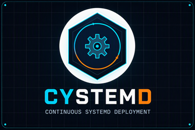
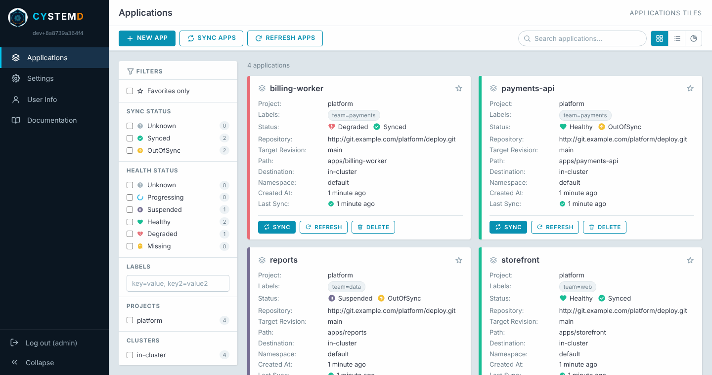
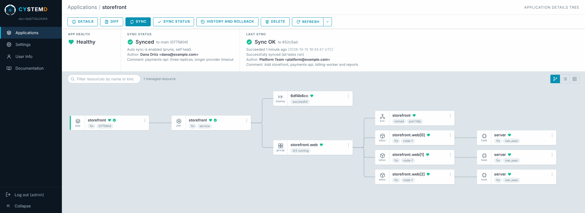
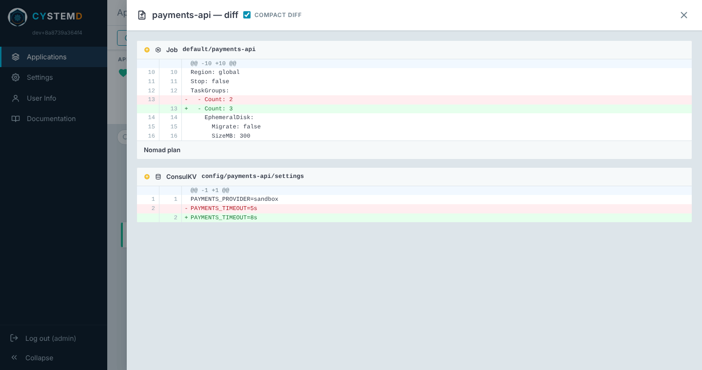
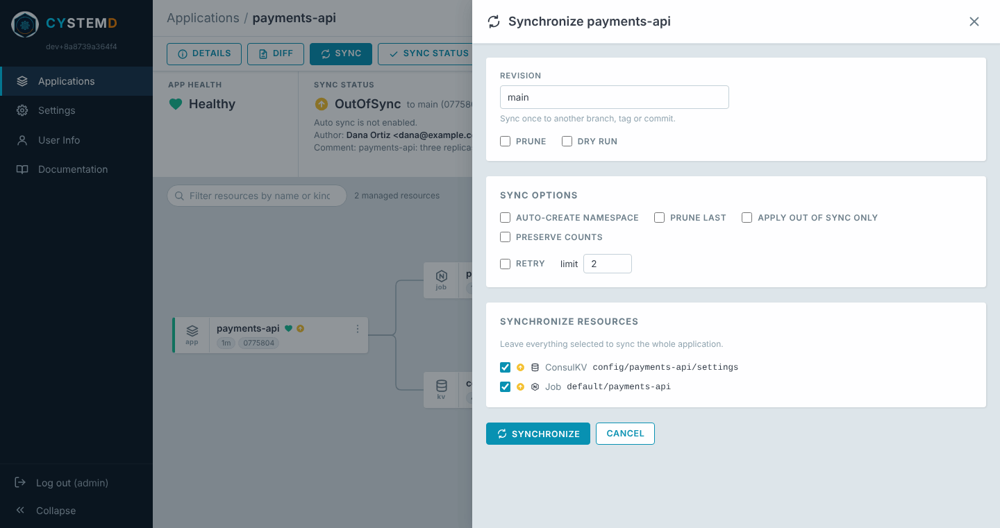
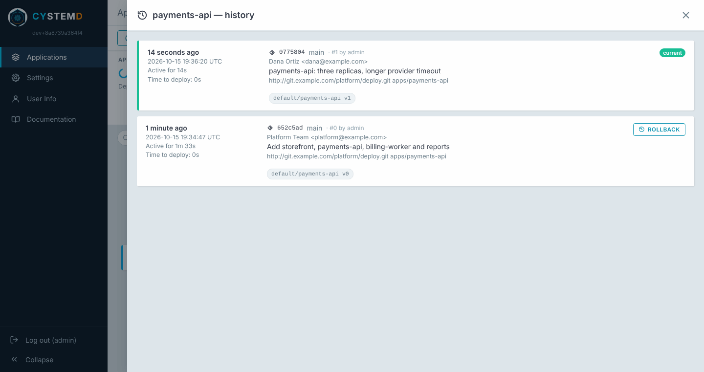
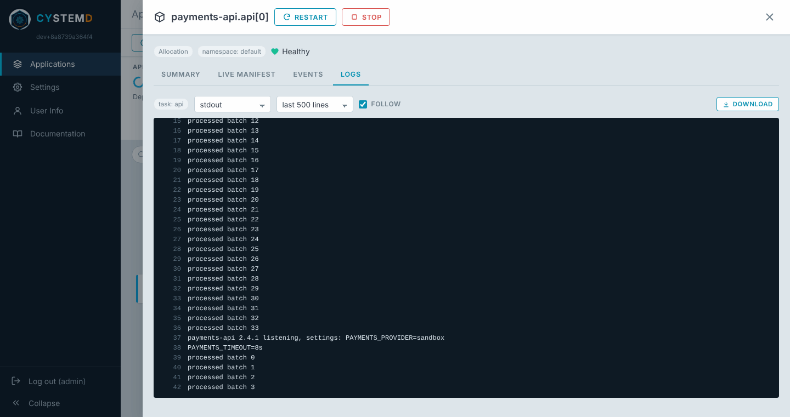

# CYSTEMD

**GitOps continuous delivery for systemd services and Nomad jobs.** CYSTEMD keeps
what runs on your hosts identical to what is in Git. It is built on a fork of
HashiCorp Nomad, keeps its state in Consul, reads secrets only through Vault
Agent, and is used through a web UI and a command line modelled on Argo CD's.



CYSTEMD v4 was a daemon on every host that pulled a `config.yml` from Git and
ran `dnf install` and `systemctl restart`. v5 hands scheduling, placement,
rollout and supervision to Nomad and keeps what made CYSTEMD useful: services
installed from packages, configured from Helm-style values files, with secrets
from Vault, now expressed as Argo CD-style Applications.
[docs/MIGRATION.md](docs/MIGRATION.md) explains the move, and `cystemd migrate`
converts a v4 installation.

## What it does

- **Applications from Git.** An Application points at a path in a Git
  repository: Nomad jobspecs (HCL2 with variables, or JSON) or a **systemd
  source**, a values file turned into a job for the built-in systemd task
  driver (package version, CPU and memory limits, configuration file, Vault
  secrets). Applications can also own Consul keys.
- **Compare, diff, sync.** CYSTEMD renders the desired state, compares it with
  the live Nomad jobs and Consul keys, and reports `Synced` or `OutOfSync`
  with a diff and Nomad's own plan. A sync can be manual, partial, a dry run or
  pinned to another revision; an automated sync can prune what Git removed and
  self-heal changes made outside Git. Sync options, waves and resource hooks
  (PreSync, PostSync, SyncFail batch jobs) follow Argo CD's.
- **Health.** Argo CD's vocabulary (`Healthy`, `Progressing`, `Degraded`,
  `Suspended`, `Missing`) computed from deployments, allocations, task states
  and service checks.
- **History and rollback** to the exact Nomad job versions a past sync
  produced, with the Consul keys of that revision.
- **The live tree** of every Application: job, deployment, task groups,
  services, allocations and tasks, with logs, events, live manifests and
  actions (restart, stop, signal, promote, …), updated as it changes.
- **Projects, RBAC, accounts and SSO.** AppProjects restrict sources and
  destinations; an Argo CD-format RBAC policy decides who may do what; users
  log in with a local account, a Nomad ACL token, or single sign-on through
  Nomad's OIDC auth methods.
- **Git webhooks** from GitHub, GitLab, Gitea, Gogs and Bitbucket make the
  comparison immediate.



## How it fits together

```
                ┌──────────────── server hosts (×3) ─────────────────┐
  browser  ────▶│ cystemd agent = Nomad server + control plane       │──▶ Git
  cystemd CLI   │   /v1/ Nomad API   /api/ CYSTEMD API   /ui/ UI     │
  Git webhooks  │ consul agent · vault-agent (AppRole, API proxy)    │
                └──────────────────────────┬─────────────────────────┘
                                           │ Nomad RPC
                ┌─────────────────── client hosts ───────────────────┐
                │ cystemd agent = Nomad client + systemd driver      │
                │ consul agent · vault-agent (host templates)        │
                │ your services: units installed from packages,      │
                │ containers, raw commands, …                        │
                └────────────────────────────────────────────────────┘
```

- **`cystemd`, the agent**, is Nomad 2.0.7 with a small, rebaseable fork: the
  systemd task driver built in, and the CYSTEMD control plane and web UI served
  by server agents on Nomad's own address (`/api/`, `/ui/`). Every Nomad
  command is still there (`cystemd job status`, `cystemd agent`, …), next to
  CYSTEMD's (`cystemd app sync`). See [docs/FORK.md](docs/FORK.md).
- **`cystemd-server`** is the same control plane as a standalone process, for
  clusters running upstream Nomad (typically as a Nomad job with a Vault Agent
  sidecar).
- **`cystemdctl`** is the command line on its own.
- **Consul** holds the state (Applications, projects, accounts), elects the
  replica that reconciles, stores the keys applications manage and reports
  service health.
- **Vault** is reached only through Vault Agent: the control plane talks to its
  API proxy, jobs log in with their Nomad workload identity.

[docs/ARCHITECTURE.md](docs/ARCHITECTURE.md) has the details.

## Quick start

You need Go 1.26, Git, `patch` and a C compiler (the agent uses cgo).

```sh
make agent                 # bin/cystemd: assembles the Nomad fork, then builds
bin/cystemd agent -dev     # a Nomad dev agent with the control plane and UI
```

Open <http://127.0.0.1:4646/ui/> and log in as `admin` with the password in
`/tmp/cystemd-dev/initial-admin-password` (`$TMPDIR/cystemd-dev` on systems
that set it).

Give it something to deploy: a Git repository with one job.

```sh
mkdir /tmp/deploy && cp examples/quickstart/hello.nomad.hcl /tmp/deploy/
git -C /tmp/deploy init -q && git -C /tmp/deploy add . && git -C /tmp/deploy commit -qm hello

export NOMAD_ADDR=http://127.0.0.1:4646
bin/cystemd ctl login -password-stdin < /tmp/cystemd-dev/initial-admin-password
bin/cystemd app create hello -repo file:///tmp/deploy -sync-policy automated -self-heal
bin/cystemd app wait hello
bin/cystemd app logs hello -tail 3
```

Edit the job in `/tmp/deploy` and commit: within the reconcile interval
(three minutes; Refresh in the UI, or a Git webhook, makes it immediate) the
Application turns `OutOfSync` and syncs itself. Stop the job behind CYSTEMD's
back (`bin/cystemd job stop hello`) and it comes back.

For production — TLS, ACLs, three servers, Vault Agents — follow
[deploy/README.md](deploy/README.md).

## The command line

The agent binary carries the commands (`cystemd app …`, with the session
commands under `cystemd ctl …` since Nomad has its own `login`), and
`cystemdctl` is the same without Nomad. Without a CYSTEMD context, the agent's
commands use `NOMAD_ADDR` and `NOMAD_TOKEN`.

```sh
cystemdctl login cystemd.example.com           # saves a context
cystemdctl app list
cystemdctl app create -f applications.yaml      # or from flags
cystemdctl app diff payments-api               # exit 1 when out of sync
cystemdctl app sync payments-api               # waits, exits 1 on failure
cystemdctl app sync payments-api -resource ConsulKV::config/payments-api/settings
cystemdctl app history payments-api
cystemdctl app rollback payments-api 3
cystemdctl app logs payments-api -f
cystemdctl app actions payments-api restart Job/payments-api
```

[docs/CLI.md](docs/CLI.md) lists every command.

## Applications

```yaml
apiVersion: cystemd.io/v1alpha1
kind: Application
metadata:
  name: payments-api
spec:
  project: platform
  source:
    repoURL: https://git.example.com/platform/deploy.git
    targetRevision: main
    path: apps/payments-api
    nomad:
      varFiles: [prod.vars.hcl]
      consulKV: consul-kv.yaml
  destination:
    name: in-cluster
    namespace: payments
  syncPolicy:
    automated:
      prune: true
      selfHeal: true
```

[docs/APPLICATIONS.md](docs/APPLICATIONS.md) is the reference: sources, the
systemd source and its values keys, sync options, waves, resource hooks,
ignored differences, health, projects and repositories. [examples/gitops](examples/gitops) is a
repository laid out for CYSTEMD.

| | |
|---|---|
|  |  |
|  |  |

## The systemd task driver

The driver runs Nomad tasks as systemd units. In *unit mode* it manages a unit
installed by a package: it installs the wanted package version, keeps the
configuration and secret files Nomad renders in place on the host, applies CPU
and memory limits through a runtime drop-in, and follows the unit's journal
into the task's logs. In *transient mode* it runs a command in a transient
unit, like `systemd-run`. Every host-mutating capability is off until the node
operator allows it. See [docs/DRIVER.md](docs/DRIVER.md).

## Building and testing

| | |
|---|---|
| `make` | `bin/cystemd-server` and `bin/cystemdctl` (Apache-2.0, no Nomad code) |
| `make agent` | `bin/cystemd`, the Nomad fork with everything built in |
| `make driver` | the systemd driver as an external Nomad plugin |
| `make test` | unit tests |
| `make test-integration` | also the tests against real Nomad, Consul and Vault binaries on `PATH` |
| `make test-e2e` | the end-to-end suite: the CLI, ACLs, Vault, the agent binary and the UI in Chromium ([e2e/doc.go](e2e/doc.go)) |
| `make lint` | gofmt and go vet |
| `make generate` | regenerate the UI's templ views |

The web UI is server-rendered Go: [templ](https://templ.guide) templates and
[htmx](https://htmx.org), vendored by checksum (`make vendor-htmx`); there is
no JavaScript build. Architecture decisions are recorded in
[docs/adr](docs/adr/README.md).

## License

CYSTEMD's own code is licensed under the [Apache License 2.0](LICENSE).
`cystemd-server`, `cystemdctl` and their packages link only HashiCorp's
MPL-2.0 API clients. The `cystemd` agent binary is built from HashiCorp Nomad,
licensed under the Business Source License 1.1, and is subject to its terms;
see [NOTICE](NOTICE) and [docs/FORK.md](docs/FORK.md).
